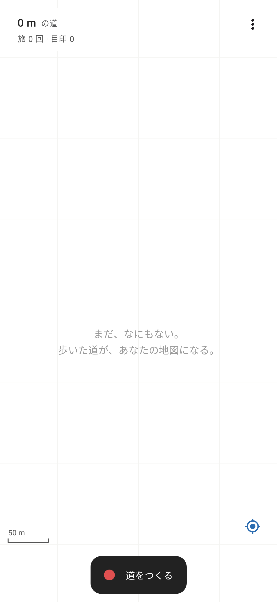
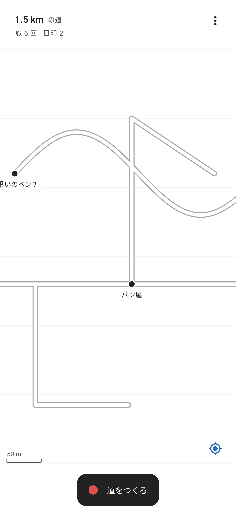

# 白紙の地図 (WhiteMap)

**地図アプリなのに、真っ白。** 歩いたところだけが道になり、あなただけの地図ができていく Android アプリです。

| はじめは真っ白 | 歩いた道が地図になる |
|---|---|
|  |  |

## できること

- **道をつくる**: ボタンを押して出かけると、通ったところに道が描かれます。画面を消していても記録を続けます（通知から停止も可能）。
- **目印を書きこむ**: 地図を長押しすると、その場所に名前つきの目印を置けます。目印をタップすると名前の変更・削除ができます。
- **地図を眺める**: 2本指で拡大・縮小／移動、ダブルタップで拡大。右下のボタンで現在地に戻って追従します。
- **記録のまとめ**: これまでに描いた道の総延長、旅の回数、目印の数を表示します。
- **書き出し**: メニューから GPX ファイルとして保存できます（他の地図アプリや GIS ソフトで開けます）。
- **すべて端末内**: 地図タイルも外部サービスも使いません。ネット接続・API キー・Google Play 開発者サービス不要で、記録は端末の中だけに保存されます。

## APK の入手方法

### GitHub Actions から（Android Studio 不要）
1. このリポジトリの **Actions** タブ → 最新の「Build APK」を開く
2. 下部の **Artifacts** から `whitemap-apk` をダウンロード
3. 中の `app-release.apk` をスマホに送ってインストール（「提供元不明のアプリ」の許可が必要です）

> release ビルドは現在デバッグ鍵で署名しています。Google Play で公開する場合は、自分の署名鍵を作って `app/build.gradle.kts` の `signingConfig` を差し替えてください。

### 手元でビルド
Android Studio でこのフォルダを開いて実行するか、Android SDK を入れた環境で:

```sh
./gradlew assembleDebug        # app/build/outputs/apk/debug/app-debug.apk
./gradlew installDebug         # 接続中の端末へインストール
./gradlew testDebugUnitTest    # テスト（app/build/outputs/render/ に画面のPNGも出力）
```

## しくみ

| 部分 | ファイル |
|---|---|
| 位置情報の記録（フォアグラウンドサービス、GPS の誤差・跳びを除去） | `location/TrackingService.kt` |
| 位置情報の取得（`LocationManager` を直接使用、Play 開発者サービス非依存） | `location/LocationUpdates.kt` |
| 保存（Room: 旅 / 地点 / 目印） | `data/` |
| 緯度経度 → 局所平面座標（メートル）への変換、道の区切り判定 | `util/Geo.kt`, `util/TrackGeometry.kt` |
| 白い地図の描画（Compose Canvas。縁取り＋白抜きの線で「道」らしく） | `ui/WhiteMapCanvas.kt` |
| 画面（ボタン、目印ダイアログ、権限、GPX 書き出し） | `ui/MapScreen.kt` |

- 道の太さは実寸 5m（縁取り込み 8m）で描き、縮小しても細くなりすぎないよう最小幅を設けています。
- 同じ道を何度通っても線が重なって 1 本の道に見えるよう、全体の縁取りを先に、白い中身を後から描いています。
- 300m 以上離れた点同士は線でつなぎません（GPS が途切れた区間をまっすぐ結ばないため）。
- 精度が 40m より悪い点や、時速 430km 相当を超える跳びは GPS の誤差として捨てます。

## 動作環境
- Android 8.0 (API 26) 以上
- 権限: 位置情報（正確な位置）、通知（記録中の表示）

## 今後のアイデア
- 歩いた範囲を「霧が晴れる」ように塗る表示
- 道の色分け（よく通る道ほど太く・濃く）
- 目印にメモや写真を添付
- 地図の画像書き出し・共有
- 自転車・電車など移動手段ごとの記録
